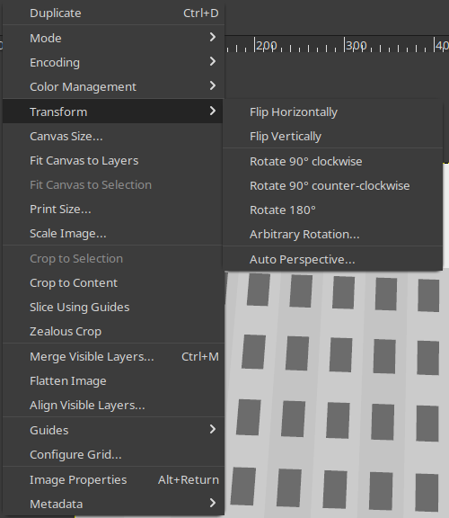

# gimp-auto-perspective

Automatic line based perspective correction for GIMP 3:
find the lines of a building that should be vertical and horizontal,
fit a rotation, lens shifts and a shear that make them so, and transform
the image. The method is that of darktable's "rotate and perspective"
module (ashift, after ShiftN).

**Status: it corrects; the dialog with its preview is new and not yet
tried in GIMP's window.** Line detection
(LSD), the fit (ashift's model, cost and RANSAC, our own Nelder-Mead),
the crop and the warp run in the core and on the command line, tested
against darktable's homography, LSD 1.6's output and facades rendered
through a camera with known angles: after the fit the facade edges are
straight within 0.02 degrees (PLAN.md, section 5.2). The plug-in
applies the result to the whole image (layers, channels, paths, the
selection) or to the layer, in one undo group, and crops; in GIMP the
facade's true edges come out vertical within 0.005 degrees (5.4). Not
yet tried on real photos.
The plan is in [PLAN.md](PLAN.md); the research behind it in
[docs/research.md](docs/research.md) and
[docs/patents.md](docs/patents.md).



## What is there

- `src/core/`: the core, without GIMP: `lsd.c` (LSD, a C port of
  OpenCV's BSD licensed implementation), `model.c` (ashift's homography
  and cost), `simplex.c` (Nelder-Mead), `ransac.c` (outliers),
  `crop.c` (the largest rectangle, and the warp), `perspective.c`
  (detection, merging of collinear segments, the fit and the automatic
  mode); the interface is `perspective.h`.
- `tools/auto-perspective-cli.c`: the core on the command line (PFM
  images, or guide lines from a text file): `lines`, `fit`, `warp`,
  `cost`, `lsd`.
- `src/plugin/main.c`: **Image > Transform > Auto Perspective...**
  (`plug-in-auto-perspective`) with its modes (Automatic, Vertical, Horizontal,
  Full, Rotation only, Guided by a path), crop, apply-to,
  interpolation, focal length (0: from EXIF), lens dependence and four
  fine tuning offsets, and a dialog with a preview (the result, the
  lines used, the crop). It returns the status, the four values and the
  mode used, so it can be scripted.
- Tests, all isolated from your own folders:
  - `tests/check.sh`: unit tests of the core, as usual and under
    AddressSanitizer and UBSan, `auto-perspective-cli` under the
    sanitizers, and `tests/recovery.py`: facades rendered through a
    camera with known angles, fitted, and measured on their true edges.
  - `tests/lsd-ref.sh`: our LSD against the reference LSD 1.6 (fetched
    at test time into tests/output, AGPL, never shipped); not part of
    `run.sh`.
  - `tests/gimp-test.sh` (also `--asan`): the plug-in in GIMP without a
    window: registration, the same parameters and pixels as the command
    line, paths, channels and the selection, every mode and format.
  - `tests/gui/gui-test.sh`: the menu and the dialog in GIMP's window on
    Broadway (needs Chrome and node).
  - `tests/run.sh`: all of them.
  - `tests/synth.py`: synthetic facades seen by a camera turned by known
    angles, the truth for the recovery tests to come.


## Building

Against the native GIMP 3 and its development files (on Debian and
Ubuntu `sudo apt install gimp libgimp-3.0-dev meson ninja-build`),
through gimp-devtools next to this folder:

```
../gimp-devtools/gimp-build.sh . meson setup build
../gimp-devtools/gimp-build.sh . ninja -C build
tests/run.sh
```

`meson setup build -Dplugin=disabled` builds only the core, the CLI and
the unit tests. Nothing here installs into your GIMP unless you run
`ninja install` with a `-Dplugindir` of your choice.

## Licence

GPL-3.0-or-later (COPYING). Parts are ported, with attribution in each
file, from darktable's ashift (GPL-3.0-or-later): the homography, the
cost, RANSAC and the crop. `src/core/lsd.c` is a port of OpenCV's
`lsd.cpp` and keeps its 3-clause BSD licence (its header and
docs/research.md have the history of that file's licence).
`tests/ref/ashift-homography.c` is darktable's code, copied unchanged
as a test oracle. Copyright 2026 David.
