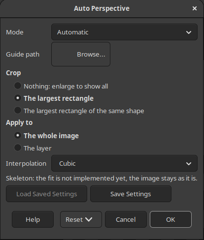

# gimp-upright

Automatic line based perspective correction ("upright") for GIMP 3:
find the lines of a building that should be vertical and horizontal,
fit a rotation, lens shifts and a shear that make them so, and transform
the image. The method is that of darktable's "rotate and perspective"
module (ashift, after ShiftN).

**Status: skeleton.** Nothing is corrected yet. The plan is in
[PLAN.md](PLAN.md), for review before the real work starts; the
research behind it in [docs/research.md](docs/research.md) and
[docs/patents.md](docs/patents.md).


## What is there

- `src/core/`: the interface of the core (`upright.h`): line segments,
  the four parameters, the modes, the fit. Line classification works;
  detection finds nothing and the fit returns the identity.
- `tools/upright-cli.c`: the core on the command line (PFM images, or
  guide lines from a text file), for the tests.
- `src/plugin/main.c`: **Image > Transform > Upright...**
  (`plug-in-upright`) with its modes (Automatic, Vertical, Horizontal,
  Full, Rotation only, Guided by a path), crop, apply-to and
  interpolation, and a dialog without preview yet. It reads the layer or
  the path and calls the core, so for now the image stays as it is.
- Tests, all isolated from your own folders:
  - `tests/check.sh`: unit tests of the core, as usual and under
    AddressSanitizer and UBSan, and `upright-cli` under the sanitizers.
  - `tests/gimp-test.sh` (also `--asan`): the plug-in in GIMP without a
    window: registration, and every mode leaves the image unchanged.
  - `tests/gui/gui-test.sh`: the menu and the dialog in GIMP's window on
    Broadway (needs Chrome and node).
  - `tests/run.sh`: all of them.
  - `tests/synth.py`: synthetic facades seen by a camera turned by known
    angles, the truth for the recovery tests to come.



## Building

With the Flatpak GIMP, through gimp-devtools (next to this folder):

```
../gimp-devtools/gimp-build.sh . meson setup build
../gimp-devtools/gimp-build.sh . ninja -C build
tests/run.sh
```

`meson setup build -Dplugin=disabled` builds only the core, the CLI and
the unit tests. Nothing here installs into your GIMP unless you run
`ninja install` with a `-Dplugindir` of your choice.

## Licence

GPL-3.0-or-later (COPYING), compatible with darktable's ashift
(GPL-3.0-or-later), which the real implementation will port with
attribution. Copyright 2026 David.
